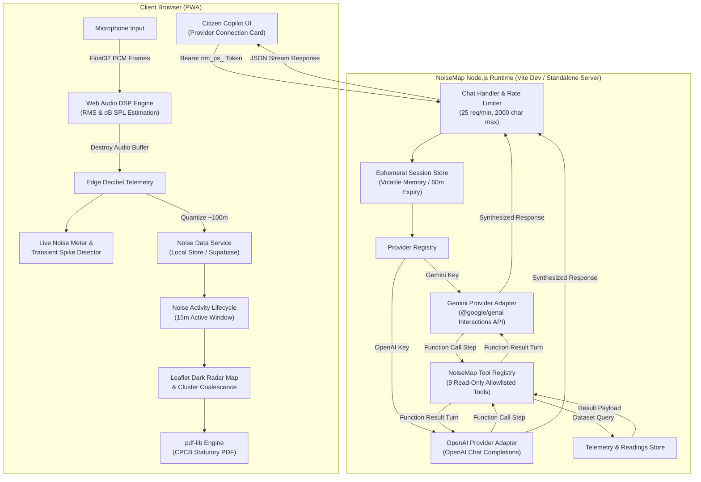

<div align="center">


<br/><br/>

# NoiseMap — Real-Time Environmental Noise Intelligence

### **Privacy-First Civic Acoustic Sensor Grid, Edge Decibel Meter, Statutory CPCB Compliance Engine & Multi-Model AI Copilot**

<br/>

[](https://noisemap-beta.vercel.app/)
[](https://vitejs.dev/)
[](https://react.dev/)
[](https://www.typescriptlang.org/)
[](https://ai.google.dev/)
[](https://platform.openai.com/)
[](https://web.dev/progressive-web-apps/)

<br/>

**🔗 Official Live Application:**  
### **👉 [https://noisemap-beta.vercel.app/](https://noisemap-beta.vercel.app/) 👈**

*Installable Progressive Web App (PWA) supported across iOS, Android, macOS, Windows, and Linux.*

<br/>

```
╔═════════════════════════════════════════════════════════════════════════════════════════════════════════════╗
║   [1. EDGE METER]  ──▶   [2. LIFECYCLE MAP]   ──▶   [3. CONSENSUS]   ──▶   [4. AI COPILOT]  ──▶   [5. ACT]     ║
║   Web Audio dB SPL       15m Freshness Life         3+ Devices             Gemini 3.8 Flash       CPCB 2000    ║
║   Transient Spikes       100m Privacy Grid          Cluster Corroboration  9 Environmental Tools  PDF Dossier  ║
╚═════════════════════════════════════════════════════════════════════════════════════════════════════════════╝
```

</div>

---

## 📑 Table of Contents

- [Overview](#-overview)
- [Key Features](#-key-features)
  - [1. Real-Time Edge Acoustic Monitoring](#1-real-time-edge-acoustic-monitoring)
  - [2. Interactive Noise Map & Spatial Quantization](#2-interactive-noise-map--spatial-quantization)
  - [3. Dynamic Noise Activity Lifecycle](#3-dynamic-noise-activity-lifecycle)
  - [4. AI Copilot (Gemini 3.8 Flash & OpenAI)](#4-ai-copilot-gemini-38-flash--openai)
  - [5. BYOK Provider Connection & Ephemeral Sessions](#5-byok-provider-connection--ephemeral-sessions)
  - [6. Statutory CPCB 2000 PDF Evidence Engine](#6-statutory-cpcb-2000-pdf-evidence-engine)
  - [7. Privacy-First Architecture ("Math Over Trust")](#7-privacy-first-architecture-math-over-trust)
- [System Architecture](#-system-architecture)
- [Technology Stack](#-technology-stack)
- [Repository Structure](#-repository-structure)
- [Local Setup & Installation](#-local-setup--installation)
  - [Prerequisites](#prerequisites)
  - [Installation](#installation)
  - [Environment Configuration](#environment-configuration)
  - [Development Commands](#development-commands)
- [AI Copilot Provider Setup](#-ai-copilot-provider-setup)
- [Automated Verification & Test Suites](#-automated-verification--test-suites)
- [Deployment Architecture](#-deployment-architecture)
  - [Local Full-Stack Server](#local-full-stack-server)
  - [Docker Production Container](#docker-production-container)
  - [Agent 37 Cloud Sandbox Deployment](#agent-37-cloud-sandbox-deployment)
- [Environmental Standards & Disclosures](#-environmental-standards--disclosures)
- [Project Status](#-project-status)
- [Project Roadmap](#-project-roadmap)
- [Contributing & Security](#-contributing--security)
- [License & Open-Source Mission](#-license--open-source-mission)

---

## ⚡ Overview

Urban noise pollution from industrial machinery, construction operations, traffic congestion, and unpermitted loudspeakers poses documented risks to sleep quality, auditory health, and cardiovascular wellness. Traditional civic enforcement remains constrained by sparse regulatory sound stations, expensive proprietary decibel meters, and bureaucratic evidence requirements.

**NoiseMap** is a privacy-first Progressive Web App (PWA) transforming consumer smartphones and personal computers into an autonomous civic acoustic intelligence network:

1. **Edge Acoustic Sensing**: Captures short audio frames through the browser Web Audio API, estimates decibel levels ($L_{eq}$ dB SPL), identifies sudden transient spikes ($\ge +15\,\text{dB}$ within $\le 300\,\text{ms}$), and immediately destroys raw audio frames in transient memory.
2. **Activity Lifecycle Mapping**: Visualizes noise measurements snapped to a privacy-preserving $\sim 100\,\text{m}$ geodetic grid. Actively manages evidence freshness with a 15-minute validity window, automatically retiring stale markers when newer quiet readings corroborate that noise has subsided.
3. **Environmental AI Copilot**: Provides a multi-model intelligence assistant capable of executing 9 allowlisted read-only server tools to analyze environmental summaries, geospatial trends, active civic clusters, and compliance drafts using Google Gemini (`gemini-3.8-flash` via the Interactions API) and OpenAI (`gpt-4o-mini`).
4. **Statutory Evidence Generation**: Compiles tamper-evident civic grievances directly into PDF format citing the **Noise Pollution (Regulation and Control) Rules, 2000** under India's *Environment (Protection) Act, 1986*.

---

## 🚀 Key Features

### 1. Real-Time Edge Acoustic Monitoring
- **Live Noise Meter**: Computes continuous estimated sound pressure levels (dB SPL) with rolling sparkline visualizers and honest standby/silence detection.
- **Transient Spike Detection**: Algorithmic surge detection isolating sudden noise spikes ($\ge +15\,\text{dB}$ rise within $\le 300\,\text{ms}$) with monotonic time validation and cooldown deduplication.
- **Noise Event History**: Bounded client-side event log recording detected surges with timestamps, measured decibels, and delta indicators.
- **Hardware Privacy Indicator**: Real-time microphone status with visual guarantees that raw audio is processed exclusively at the edge and never transmitted.
- **Audio Diagnostics Modal**: Hardware permission checks, device enumeration, and failure recovery.

### 2. Interactive Noise Map & Spatial Quantization
- **Privacy-Snapping Grid**: Coordinates are quantized to 3 decimal places ($\sim 100\,\text{m}$ sectors) on the device:
  $$\text{lat}_{\text{grid}} = \frac{\lfloor \text{lat} \times 1000 \rceil}{1000}, \quad \text{lng}_{\text{grid}} = \frac{\lfloor \text{lng} \times 1000 \rceil}{1000}$$
  Masks individual residential addresses while preserving regional civic utility.
- **Dynamic Leaflet Radar**: High-contrast dark radar layers (CARTO Dark Matter / Stadia / OSM Dark) displaying active noise sectors, incident hotspots, and sensitivity zones.
- **Cluster Coalescence**: Multiple observations inside a single grid sector coalesce into unified, representative markers.

### 3. Dynamic Noise Activity Lifecycle
Traditional maps suffer from "permanent noise pollution" artifacts where historic complaints permanently clutter live views. NoiseMap enforces a dynamic activity lifecycle:

| State | Freshness & Evidence Condition | Map Representation |
|:---|:---|:---|
| **`ACTIVE`** | Elevated reading ($\ge 68\,\text{dB}$) recorded within the last **15 minutes**. | High-visibility pulsing crimson sector marker. |
| **`MONITORING`** | Reading is **15 to 60 minutes** old without subsequent quiet readings. | Amber indicator denoting aging evidence. |
| **`QUIET / RESOLVED`** | Newer reading in grid is $< 68\,\text{dB}$, OR evidence is **$> 60\,\text{minutes}$** old. | Automatically retired from the live map into historical audit views. |

*Non-Destructive Retention*: Superseded and resolved records remain preserved in historical audit datasets for trend analysis.

### 4. NoiseMap FAQ Copilot (Offline Deterministic Mode)
A lightweight, offline environmental assistant embedded directly in the application:
- **Deterministic Predefined Answers**: Delivers instant, consistent responses using a local FAQ database covering sound exposure, decibel thresholds, map features, incident lifecycles, and reporting protocols.
- **Zero Cloud AI Dependency**: Operates entirely in the browser without calling Google Gemini, OpenAI, or external language models.
- **Natural Language Matching**: Features case-insensitive text normalization, punctuation removal, alternative question phrasing matching, and keyword/token scoring.
- **Helpful Fallback Guidance**: When an unsupported question is submitted, the chatbot provides clear fallback guidance along with clickable topic categories and suggested questions.
- **Extensible FAQ Database**: Easily expanded by adding new entries to [`src/data/noiseMapFaqData.js`](file:///c:/Users/abhis/OneDrive/Desktop/NoiseMap/src/data/noiseMapFaqData.js) with zero core engine alterations required.

### 5. Simulated Gemini API-Key Demonstration Element
The interface retains a demonstration-only API-key configuration component:
- **Transparent Demonstration Element**: Clearly labelled as `Gemini API Key — Demo UI Only` with explicit notices advising users not to enter real API credentials.
- **Zero Credential Transmission**: The input does not collect, transmit, validate, or store real API keys.
- **Zero Persistent Storage**: Values are never written to `localStorage`, `sessionStorage`, cookies, database tables, or application logs.
- **Simulated Preview Action**: The "Preview Demo UI" button provides non-functional visual preview feedback (`Demo interface preview activated. No API connection was created.`) without claiming any real connection.
- **Independent FAQ Operation**: The FAQ assistant operates immediately out of the box without requiring credentials or provider configuration.

### 6. Statutory CPCB 2000 PDF Evidence Engine
Compiles court-ready and administrative-ready legal dossiers under **The Noise Pollution (Regulation and Control) Rules, 2000**:
- **Rule 5 Citations**: Violations of nocturnal loudspeaker prohibitions, industrial sound exceedances, and sensitive zone breaches.
- **Rule 7 Formal Complaints**: Pre-formatted complaints addressed to District Magistrates, Police Commissioners, and State Pollution Control Board officers.
- **Client-Side Vector Compilation**: Compiled in $< 400\,\text{ms}$ using `pdf-lib` entirely in the client browser, guaranteeing that citizen complaints are never transmitted to third-party document processing servers.
- **Mandatory Disclosure**: Discloses the technical distinction between logarithmic equivalent sound pressure ($L_{eq}$) and arithmetic means.

### 7. Privacy-First Architecture ("Math Over Trust")
```
Raw Audio Frames ──▶ [Transient RAM Buffer] ──▶ RMS Computation ──▶ [Buffer Destroyed]
                                                         │
                                               dB SPL Metric Only
                                                         │
                                                         ▼
GPS Coordinates  ──▶ [Math Quantization: 3 Decimals] ──▶ ~100m Privacy Sector
```
- **Zero Raw Audio Storage**: Microphone samples are processed into RMS scalar values and immediately discarded. No audio recordings or voice clips are stored or uploaded.
- **Zero Mandatory KYC**: No login, Google OAuth, phone numbers, or email requirements for core acoustic monitoring. Ephemeral cryptographic tokens are generated locally.

---

## 🏗️ System Architecture



---

## 🛠️ Technology Stack

| Layer | Technology | Purpose |
|:---|:---|:---|
| **Frontend Framework** | React 18.3.1 | Declarative component UI |
| **Language** | TypeScript 5.7.3 | Strict end-to-end type safety |
| **Build & Tooling** | Vite 5.4.14 | Rapid Hot Module Replacement and production bundling |
| **Styling** | Tailwind CSS 3.4.17 | Tactical, high-contrast HUD design system |
| **Audio Processing** | Web Audio API (`AnalyserNode`) | In-browser DSP, RMS energy calculation, dB SPL estimation |
| **Mapping Engine** | Leaflet 1.9.4 & React-Leaflet 4.2.1 | Geodetic radar, sector clustering, tile rendering |
| **Cartography Tiles** | CARTO Dark Matter / Stadia Maps | High-contrast zero-key map canvas |
| **Visualizations** | Chart.js 4.4.8 & React-Chartjs-2 5.3.0 | Rolling trend sparklines and decibel histograms |
| **Document Generation**| `pdf-lib` 1.17.1 | Client-side vector compilation of CPCB compliance dossiers |
| **Icons & UI** | Lucide React 1.16.0 | Vector iconography |
| **AI Integration** | `@google/genai` 2.31.0 | Official Google GenAI SDK for the Interactions API |
| **AI Models** | `gemini-3.8-flash` & `gpt-4o-mini` | Low-latency environmental reasoning and tool calling |
| **Backend Runtime** | Node.js (ES Modules) | Standalone server (`server.js`) & Vite API middleware |
| **State & Persistence** | Browser Local Storage / Supabase Client | Offline-first storage with optional cloud sync |
| **Containerization** | Docker (Alpine Linux multi-stage) | Production container workload for Agent 37 & cloud hosts |

---

## 📁 Repository Structure

```text
NoiseMap/
├── public/                       # PWA icons, manifest, service worker, and brand SVG assets
│   ├── banner-logo.svg           # High-resolution vector header logo
│   ├── manifest.webmanifest      # PWA install configuration
│   └── sw.js                     # Offline caching service worker
├── server/                       # Standalone Node.js backend & AI runtime
│   ├── providers/                # Provider adapters
│   │   ├── geminiProvider.js     # Google GenAI Interactions API adapter (gemini-3.8-flash)
│   │   ├── openaiProvider.js     # OpenAI Chat Completions adapter (gpt-4o-mini)
│   │   └── providerRegistry.js   # Dynamic provider dispatch & credential validation
│   ├── aiService.js              # System prompt, guardrails, rate limiting, and config
│   ├── chatHandler.js            # POST /api/copilot/chat & provider session HTTP routes
│   ├── noiseMapTools.js          # 9 allowlisted read-only environmental data tools
│   ├── server.js                 # Production HTTP server entry point (port 3001)
│   └── sessionStore.js           # Ephemeral volatile memory session manager
├── src/                          # Frontend React + TypeScript application source
│   ├── components/               # UI components
│   │   ├── audio/                # LiveNoiseMeter, MicrophonePrivacyIndicator, EventHistory
│   │   ├── copilot/              # CopilotView, ChatMessageItem, ProviderConnectionCard
│   │   ├── map/                  # NoiseMap radar, sector markers, spatial controls
│   │   ├── measure/              # 10s Sampling HUD, Avatar companion, calibration controls
│   │   └── evidence/             # CPCB legal dossier exporter, incident telemetry views
│   ├── services/                 # Frontend business logic & edge computing
│   │   ├── aiCopilotService.ts   # Session client & HTTP chat transport
│   │   ├── audioDspService.ts    # Web Audio API AnalyserNode & RMS DSP math
│   │   ├── complaintPdfService.ts# Client-side pdf-lib dossier compilation
│   │   ├── incidentEngine.ts     # Multi-device spatial clustering algorithms
│   │   └── noiseActivityLifecycleService.ts # 15m evidence freshness & marker retirement
│   ├── types/                    # Core TypeScript definitions (readings, incidents, tools)
│   ├── App.tsx                   # Main application layout, routing & mode switches
│   └── main.tsx                  # Application entry point
├── scripts/                      # Automated test & verification suites
│   ├── test-gemini-interactions.js       # 20-test Gemini Interactions API regression suite
│   ├── test-master-platform-verification.js # 14-test environmental platform verification
│   ├── test-provider-connection.js      # 15-test multi-provider & ephemeral session suite
│   ├── test-ai-copilot-stage2.js         # 20-test tool calling & CPCB statutory checks
│   ├── test-ai-copilot.js                # 12-test prompt sanitization & guardrails suite
│   └── test-noise-activity-lifecycle.js # 12-test 15-minute activity lifecycle suite
├── docs/                         # Architecture guides & deployment documentation
│   ├── AGENT37_DEPLOYMENT_GUIDE.md      # Agent 37 container deployment instructions
│   └── AI_COPILOT_PROVIDER_GUIDE.md     # Multi-model connection & BYOK user guide
├── Dockerfile                    # Multi-stage production container manifest
├── package.json                  # Scripts and dependencies
└── vite.config.ts                # Vite configuration with full-stack dev API middleware
```

---

## 💻 Local Setup & Installation

### Prerequisites
- **Node.js**: `v20.x` or higher (verified on Node `v20`, `v22`, and `v24`).
- **Package Manager**: `npm` (bundled with Node.js) or `pnpm`.
- **Operating System**: macOS, Linux, or Windows (PowerShell supported).

### Installation

```bash
# 1. Clone the official repository
git clone https://github.com/abhisheksharma075/NoiseMap.git

# 2. Enter project directory
cd NoiseMap

# 3. Install dependencies
npm install
```

### Environment Configuration

Create a local `.env` configuration file from the provided example:

```bash
# On Linux / macOS:
cp .env.example .env

# On Windows PowerShell:
Copy-Item .env.example .env
```

#### Environment Variables Overview

| Variable | Environment | Default Value | Description |
|:---|:---|:---|:---|
| `GEMINI_API_KEY` | Server Secret | *(Optional)* | Server-default Google Gemini API key. *(Users can also input their own key in the UI).* |
| `GEMINI_MODEL` | Server Config | `gemini-3.8-flash` | Gemini model identifier used for Interactions API calls. |
| `OPENAI_API_KEY` | Server Secret | *(Optional)* | Server-default OpenAI key for GPT models. |
| `OPENAI_MODEL` | Server Config | `gpt-4o-mini` | OpenAI model identifier used for completions. |
| `PORT` | Server Config | `3001` | HTTP port for the standalone production server. |
| `ALLOWED_ORIGIN` | Server Config | `*` | Allowed CORS origins for external API access. |
| `VITE_MAP_PROVIDER` | Client Public | `stadia_dark` | Default map tile provider (`stadia_dark`, `osm_dark`, `carto_dark`). |
| `VITE_SUPABASE_URL` | Client Public | *(Optional)* | Cloud Supabase project URL (NoiseMap operates offline without it). |
| `VITE_SUPABASE_ANON_KEY` | Client Public | *(Optional)* | Cloud Supabase public anonymous key. |

> [!NOTE]
> Setting server API keys is **completely optional** for local development. If no server key is configured, users can click the key icon in the Copilot header to connect their own Gemini or OpenAI key securely through the built-in BYOK interface.

### Development Commands

```bash
# Start Vite development server (includes full-stack /api middleware)
npm run dev

# Run all 6 automated test suites (93 tests total)
npm run test:all

# Run individual test suites
npm run test:gemini       # Gemini 3.8 Flash Interactions API tests
npm run test:provider     # Multi-provider connection & session tests
npm run test:copilot      # AI Copilot guardrail & sanitization tests

# Build production bundle with TypeScript type-checking
npm run build

# Start standalone Node.js production server
npm run server
```

---

## 🤖 AI Copilot Provider Setup

NoiseMap AI Copilot supports both **Google Gemini** and **OpenAI**. Users can connect their own credentials directly through the chatbot UI:

```
[Citizen UI] ──▶ Click "AI Provider" ──▶ Select Gemini or OpenAI ──▶ Enter Key ──▶ Instant Validation
```

### 1. Google Gemini (Recommended)
- **Model**: `gemini-3.8-flash`
- **Protocol**: Google GenAI Interactions API (`@google/genai`)
- **Key URL**: Get a free API key at [Google AI Studio](https://aistudio.google.com/apikey).
- **Features**: Full support for all 9 read-only NoiseMap environmental data tools and multi-turn function calling.

### 2. OpenAI
- **Model**: `gpt-4o-mini`
- **Protocol**: OpenAI Chat Completions API with structured JSON Schema tools
- **Key URL**: Get an API key at [OpenAI Platform](https://platform.openai.com/api-keys).
- **Features**: Fast response times with function-calling support.

### Safe Credential Management
- Submitting an API key performs a minimal model ping (`input: "ping"`).
- Upon success, the server creates an ephemeral token (`nm_ps_...`) valid for 60 minutes of idle time.
- The key is **never saved to disk**, never logged, and never included in API responses.
- Clicking **Disconnect** in settings immediately purges the session from memory.

---

## 🧪 Automated Verification & Test Suites

NoiseMap features 6 verification suites covering edge audio DSP, geospatial math, AI provider interactions, and incident lifecycles:

```bash
npm run test:all
```

```text
========================================================================
⚡ NOISEMAP AUTOMATED VERIFICATION RESULTS (93/93 PASSED)
========================================================================

✔ [TEST SUITE 1/6] Gemini Interactions API & 3.8 Flash (20/20 PASSED)
  - gemini-3.8-flash default across services and session stores
  - v1beta/interactions endpoint routing and parameter validation
  - Redundant models/ prefix sanitization
  - Multi-turn function_result step submission & 3-turn loop limit
  - HTTP 404 (MODEL_UNAVAILABLE), 400 (INVALID_KEY), 429 (QUOTA_EXCEEDED) classification
  - Zero raw credential leakage in error messages and API payloads

✔ [TEST SUITE 2/6] Environmental Platform Master Verification (14/14 PASSED)
  - Haversine geodesic proximity queries and bounds enforcement
  - All 9 allowlisted environmental tools registered and executable
  - 15m consensus clustering (3+ independent devices)
  - Tamper-evident CPCB PDF dossier compilation with mandatory disclosures

✔ [TEST SUITE 3/6] Multi-Model Provider Connection (15/15 PASSED)
  - Key validation for Google Gemini & OpenAI
  - Ephemeral session generation (nm_ps_ tokens with masked key previews)
  - Disconnect session invalidation and idle eviction
  - Cross-provider boundary isolation

✔ [TEST SUITE 4/6] AI Copilot Stage 2 Environmental Integration (20/20 PASSED)
  - 2-turn function-calling loops with tool telemetry capture
  - CPCB statutory grievance drafts requiring citizen review
  - Data provenance reporting (autonomous_local_pwa_store mode)

✔ [TEST SUITE 5/6] AI Copilot Stage 1 Guardrails (12/12 PASSED)
  - 2,000-character input ceiling and 20-turn conversation history bounds
  - 25 requests/min in-memory rate limiting
  - Honest 503 CONFIG_MISSING errors (zero fake simulated answers)

✔ [TEST SUITE 6/6] Real-Time Noise Activity Lifecycle (12/12 PASSED)
  - 15-minute active evidence window for noise markers
  - Older high-noise markers superseded by newer quiet readings
  - Aging transition to resolved without raw historical data loss
  - GPS coordinate quantization to ~100m spatial sectors
```

---

## 🚢 Deployment Architecture

### Local Full-Stack Server
In local development, `vite.config.ts` mounts an internal Node.js middleware for `/api/copilot/*` and `/api/health`. Running `npm run dev` serves both the frontend and the AI API concurrently on port `5173`.

### Docker Production Container
NoiseMap includes a secure, production-hardened multi-stage `Dockerfile`:
```bash
# Build production container image
docker build -t noisemap:latest .

# Run containerized application
docker run -p 3001:3001 \
  -e GEMINI_API_KEY="your_optional_server_key" \
  -e GEMINI_MODEL="gemini-3.8-flash" \
  noisemap:latest
```
- **Builder Stage**: Compiles frontend assets with `tsc && vite build`.
- **Runner Stage**: Minimal Alpine Linux image running under an unprivileged `node` user.
- **Built-in Healthcheck**: Queries `GET /api/health` every 30 seconds.

### Agent 37 Cloud Sandbox Deployment
The repository includes a ready-to-deploy configuration for Agent 37 container workloads:
- Detailed environment configuration, port mapping, and memory limits are documented in [`docs/AGENT37_DEPLOYMENT_GUIDE.md`](./docs/AGENT37_DEPLOYMENT_GUIDE.md).
- *Deployment Status*: Container manifest is fully prepared and validated locally; cloud sandbox activation is ready upon user authorization.

---

## ⚖️ Environmental Standards & Disclosures

### CPCB Permissible Noise Standards (India)
NoiseMap references the statutory ambient noise standards defined in Schedule to Rule 3(1) and 4(1) of the **Noise Pollution (Regulation and Control) Rules, 2000**:

| Zone Classification | Daytime Limit (06:00 – 22:00) | Nighttime Limit (22:00 – 06:00) |
|:---|:---:|:---:|
| **Industrial Area** | $75\,\text{dB(A)}$ | $70\,\text{dB(A)}$ |
| **Commercial Area** | $65\,\text{dB(A)}$ | $55\,\text{dB(A)}$ |
| **Residential Area** | $55\,\text{dB(A)}$ | $45\,\text{dB(A)}$ |
| **Silence Zone** *(within 100m of hospitals, educational institutions, courts)* | $50\,\text{dB(A)}$ | $40\,\text{dB(A)}$ |

### Sensor Precision & Measurement Disclosure
> [!IMPORTANT]
> **Measurement Notice**: Decibel values displayed by NoiseMap are calculated using standard Web Audio API root-mean-square (RMS) energy conversions and represent **estimated sound pressure levels ($L_{eq}$ dB SPL)**. Ordinary smartphone and laptop consumer microphones are uncalibrated MEMS transducers with non-linear frequency responses. Measurements should be used for civic awareness, comparative trends, and community evidence gathering, and should not be treated as certified Class 1 / Class 2 sound level meter measurements in judicial proceedings.

---

## 📊 Project Status

| Area | Feature | Status | Notes |
|:---|:---|:---:|:---|
| **Audio DSP** | Live Noise Meter & Sparklines | **Verified** | Real-time edge calculation via Web Audio API. |
| **Audio DSP** | Transient Spike Detection | **Verified** | Algorithmic $+15\,\text{dB}$ surge detection with cooldown. |
| **Audio DSP** | Hardware Privacy Indicator | **Verified** | Real-time UI indicator confirming zero raw audio retention. |
| **Mapping** | Spatial Grid Snapping (~100m) | **Verified** | Geodetic 3-decimal mathematical coordinate quantization. |
| **Mapping** | 15m Noise Activity Lifecycle | **Verified** | Stale evidence retirement; newer quiet readings supersede loud markers. |
| **AI Copilot** | Gemini Interactions API (`gemini-3.8-flash`) | **Verified** | Official `@google/genai` SDK with multi-turn tool calling. |
| **AI Copilot** | OpenAI Integration (`gpt-4o-mini`) | **Verified** | Standard OpenAI Chat Completions adapter with JSON schema tools. |
| **AI Copilot** | 9 Allowlisted Environmental Tools | **Verified** | Read-only server tools with bounded execution loops. |
| **BYOK Security** | Ephemeral In-Memory Session Store | **Verified** | Volatile RAM storage, 60m expiry, masked key previews. |
| **Compliance** | CPCB Statutory PDF Dossier Engine | **Verified** | Client-side `pdf-lib` vector document compiler. |
| **Storage** | Local-First Offline Storage | **Verified** | In-memory and local storage operational without external dependencies. |
| **Storage** | Cloud Database Synchronization | **Config-Dependent** | Activates automatically when `VITE_SUPABASE_URL` is configured. |
| **Deployment**| Production Docker Container | **Verified** | Multi-stage Dockerfile verified with built-in healthchecks. |
| **Deployment**| Agent 37 Cloud Deployment | **Prepared** | Manifest and guide prepared in `docs/`; ready for deployment. |

---

## 🗺️ Project Roadmap

- [ ] **Hardware Microphone Calibration Profiles**: Device-specific calibration presets for popular smartphone models to improve absolute dB SPL accuracy.
- [ ] **Spatial Interpolation Iso-contour Maps**: Inverse Distance Weighting (IDW) or Kriging algorithms to generate smooth continuous sound heat contours between discrete sector readings.
- [ ] **P2P Local Mesh Synchronization**: WebRTC data channels for direct device-to-device local consensus in areas with degraded cellular connectivity.
- [ ] **Automated Incident Dossier Dispatch**: Citizen-approved email forwarding of generated CPCB PDF dossiers directly to designated municipal grievance portals.

---

## 🤝 Contributing & Security

### Contributing
Contributions to NoiseMap are welcome!
1. Fork the repository and create a feature branch (`git checkout -b feature/acoustic-improvement`).
2. Verify all test suites pass cleanly before opening a pull request:
   ```bash
   npm run test:all
   npm run build
   ```
3. Ensure no private API keys, secrets, or credential tokens are committed.
4. Submit a Pull Request with a clear description of the improvements.

### Security
- **No Secrets in Source**: Never commit `.env` or hardcode credentials into client or server code.
- **Reporting Vulnerabilities**: If you discover a security vulnerability or credential leak issue, please open an issue or contact the repository maintainers through the project repository.

---

## 📄 License & Open-Source Mission

The NoiseMap application and documentation are maintained for open civic and environmental research. Formal open-source licensing terms will be specified upon public release. All rights in third-party libraries belong to their respective copyright holders.

<br/>

<div align="center">

**[Explore Live Demo](https://noisemap-beta.vercel.app/)** • **[Report an Issue](https://github.com/abhisheksharma075/NoiseMap/issues)** • **[Documentation](./docs/)**

<br/>

*Designed and engineered for quieter, healthier, and legally empowered communities.*

</div>
