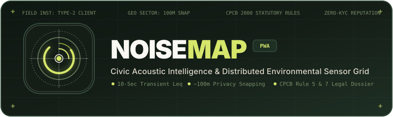
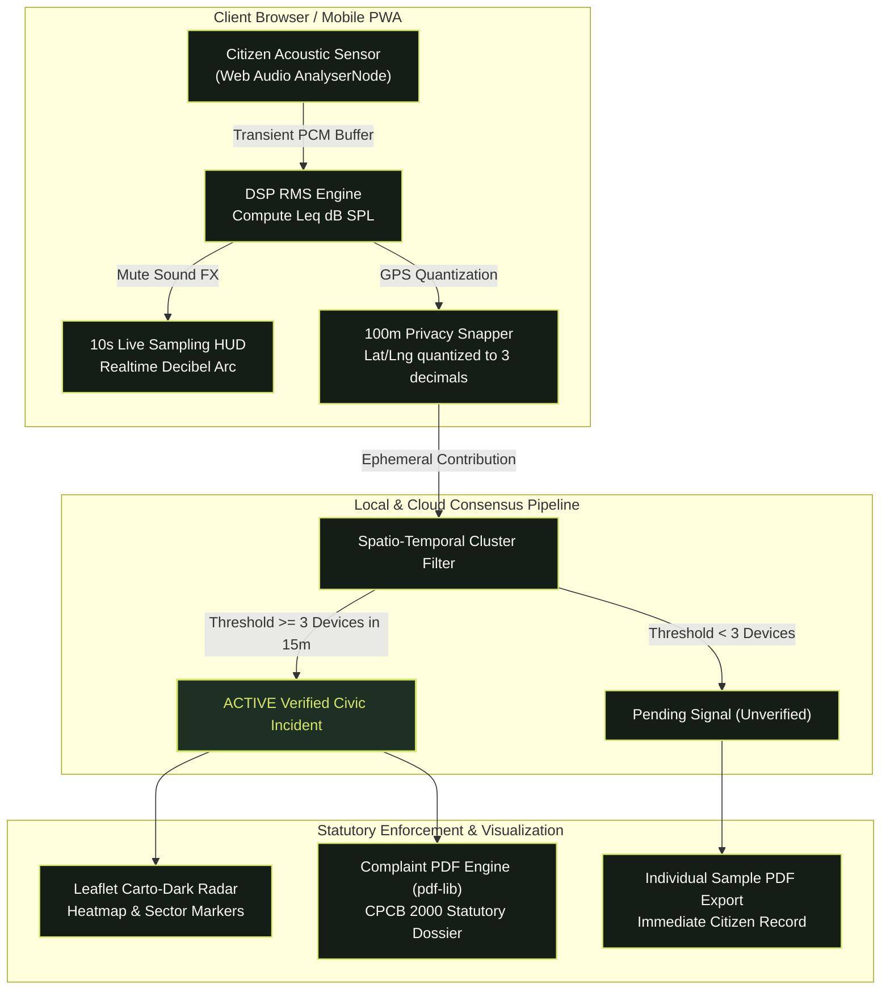

<div align="center">



<br/><br/>

# 🌐 NoiseMap: Civic Acoustic Intelligence Grid 

### **Privacy-Preserving Distributed Environmental Noise Monitoring & Statutory CPCB Compliance Engine**

<br/>

[](https://noisemap-beta.vercel.app/)
[](https://vitejs.dev/)
[](https://react.dev/)
[](https://www.typescriptlang.org/)
[](https://web.dev/progressive-web-apps/)
[](LICENSE)

<br/>

**🔗 Official Live Application noise map:**  
### **👉 [https://noisemap-beta.vercel.app/](https://noisemap-beta.vercel.app/) 👈**

*Instant PWA installation supported on iOS, Android, macOS, Windows, and Linux.*

<br/>

```
╔═══════════════════════════════════════════════════════════════════════════════════════════════════╗
║   [1. MEASURE]    ──▶    [2. MAP]    ──▶    [3. VERIFY]    ──▶    [4. ALERT]    ──▶    [5. ACT]     ║
║   1-Tap DSP Audio     Realtime Radar      3+ Consensus        Geo-Fenced Alerts   CPCB Dossier    ║
║   True Leq (dB SPL)   100m Privacy Grid   Anti-Spoof Hash     Residential/School  Rule 5 & 7 PDF  ║
╚═══════════════════════════════════════════════════════════════════════════════════════════════════╝
```

<p align="center">
  <a href="#-executive-summary">Executive Summary</a> •
  <a href="#-core-capabilities">Core Capabilities</a> •
  <a href="#-system-architecture">Architecture</a> •
  <a href="#-interactive-acoustic-companion">Acoustic Avatar</a> •
  <a href="#-cpcb-statutory-evidence-engine">CPCB PDF Engine</a> •
  <a href="#-privacy-first-engineering">Privacy Architecture</a> •
  <a href="#-tactile-sound-feedback">Audio System</a> •
  <a href="#-technology-stack">Tech Stack</a> •
  <a href="#-getting-started">Getting Started</a> •
  <a href="#-verification--testing">Test Suite</a>
</p>

</div>

---

## ⚡ Executive Summary

Urban noise pollution poses severe risks to cardiovascular health, sleep quality, and mental well-being, yet civic enforcement remains paralyzed by expensive proprietary decibel meters and bureaucratic complaint procedures. 

**NoiseMap** is a modern, privacy-first Progressive Web App (PWA) transforming everyday smartphones into an interconnected, autonomous civic acoustic sensor grid. It allows citizens to:
1. Conduct precision 10-second sound pressure measurements ($L_{eq}$) via browser-native Web Audio DSP.
2. View crowd-sourced noise heatmaps snapped to privacy-preserving $\sim 100\,\text{m}$ geodetic grids.
3. Automatically cluster synchronous community reports into verified multi-witness incidents (3+ independent devices within a 15-minute window).
4. Export legally compliant Central Pollution Control Board (**CPCB The Noise Pollution Rules, 2000**) grievance dossiers directly to PDF in $< 400\,\text{ms}$.

---

## 🚀 Core Capabilities

| Feature | Description | Technical Implementation |
|:---|:---|:---|
| 🎙️ **Micro-Transducer Sampling** | 1-Tap 10-second acoustic recording with continuous $L_{eq}$ computation. | Web Audio API `AnalyserNode`, Float32Array RMS processing, logarithmic dB SPL calibration. |
| 🛡️ **Zero-Raw Audio Retention** | Audio buffers reside solely in transient RAM and are discarded immediately. | Hardware streams terminated; zero binary audio leaves the device. |
| 📍 **Geodetic Privacy Snapping** | Locations are mathematically quantized to 3 decimal places ($\sim 100\,\text{m}$ grid). | $\text{coord}_{\text{snapped}} = \lfloor \text{coord} \times 1000 \rceil / 1000$, masking residential addresses. |
| 🤝 **Multi-Contributor Consensus** | Solitary reports remain unverified until corroborated by 3+ devices. | Spatio-temporal cluster engine (100m radius, 15-minute sliding window). |
| 📄 **Statutory CPCB PDF Generator** | 1-click legal evidence generation citing Rules 5 & 7 of the Noise Pollution Rules 2000. | Client-side vector document compilation using `pdf-lib` without server roundtrips. |
| 🤖 **Acoustic Avatar Companion** | Real-time reactive visual companion reflecting ambient decibels and sampling states. | Pure vector SVG animation engine synchronized to measurement state machines. |
| 🎵 **Tactile Sound Feedback** | High-precision synthesized mallet/marimba taps and chord harmonics. | Browser Web Audio oscillator synthesis with mic-active silence safeguards. |
| 📱 **Zero-Friction Offline PWA** | Installable to homescreens with zero login, zero phone numbers, and full offline caching. | Vite PWA plugin, ServiceWorker cache, ephemeral UUID cryptographic credentials. |

---

## 🏗️ System Architecture



---

## 🎨 Visual Identity & High-Classic Design

NoiseMap adopts a purposeful, high-classic environmental palette inspired by precision laboratory instruments and field acoustic telemetry:

* **Deep Obsidian Forest (`#141E17` / `#1E2F23`):** Primary structural surface and brand foundation.
* **Warm Paper (`#FAF8F2` / `#F4F1E8`):** Clean, high-legibility card surfaces and typography.
* **Signal Lime (`#D5E66B` / `#E2F075`):** Selected focus, live decibel telemetry, and calibrated gauge sweeps.
* **Muted Olive (`#798E69`):** Operational baseline indicators and intermediate frequency tags.
* **Terracotta Amber (`#C46E50` / `#F59E0B`):** Threshold breaches and statutory violation flags.

---

## 🤖 Interactive Acoustic Companion ("NoiseMap Guardian")

Positioned inside the circular Citizen Acoustic Sensor interface, the companion dynamically communicates sensor states:

| State | Trigger / dB Level | Avatar Expression | Sensor Action |
|:---|:---|:---|:---|
| **`IDLE`** | Ready / Standby | Resting smile, sage green headset | Calibrated 240° arc standby; tap to measure |
| **`LISTENING`** | 10-sec Sampling active | Focused pupils, live acoustic sound wave mouth, pulsing rings | **Live decibel HUD** continuously updates in real-time |
| **`LOW`** | Completed $< 50.0\,\text{dB}$ | Gentle smile, curved eyes, Forest Green accents | Compliant quiet ambient environment |
| **`MODERATE`** | Completed $50.0\text{--}69.9\,\text{dB}$ | Observant alert eyes, Muted Olive accents | Standard urban ambient baseline |
| **`HIGH`** | Completed $\ge 70.0\,\text{dB}$ | Concerned angled brows, Terracotta alert glow | Exceeds daytime limit; prompts statutory dossier export |
| **`ERROR`** | Hardware/Mic Denied | Neutral straight mouth, warning pupil shade | Hardware permission banner displayed |
| **`SUBMITTED`** | Consensus grid confirmed | Joyful nod, lime halo, ascending chime | Triggers success harmonic chime & civic points |

---

## 📄 CPCB Statutory Evidence Engine

NoiseMap generates court-ready and administrative-ready complaints under **The Noise Pollution (Regulation and Control) Rules, 2000** (*Environment (Protection) Act, 1986*):

- **Rule 5 Violation:** Restrictions on the use of loudspeakers, public address systems, and sound-producing instruments.
- **Rule 7 Redressal:** Right of aggrieved citizens to report violations to designated District Magistrates, Police Commissioners, or SPCB Officers.
- **Instant Client-Side Vector Compilation:** The `ComplaintPdfService` compiles PDFs entirely inside the browser using `pdf-lib` in $< 400\,\text{ms}$, guaranteeing complete privacy without transmitting documents over network APIs.
- **Dual Export Pathways:**
  1. **Verified Incidents:** Complete multi-witness dossiers with confidence ratings, device counts, and statutory citations.
  2. **Raw Citizen Readings:** Instant 1-click sample export for individual contributors prior to multi-party consensus.

---

## 🔒 Privacy-First Engineering: Math Over Trust

```
Raw Ambient Waves ──▶ [Transient RAM Buffer] ──▶ RMS Computation ──▶ [Buffer Destroyed]
                                                         │
                                               dB SPL Metric Only
                                                         │
                                                         ▼
GPS Lat/Lng       ──▶ [Math Quantization: 3 Decimals] ──▶ ~100m Privacy Sector
```

1. **Zero Raw Audio Storage:** Ambient sound is converted to Float32 sample frames, analyzed for RMS energy, and **immediately destroyed in memory**. No audio recordings or voice snippets are ever stored or uploaded.
2. **Mathematical Coordinate Quantization:** Precise GPS coordinates are snapped to a 100m grid on the device:
   $$\text{lat}_{\text{grid}} = \frac{\lfloor \text{lat} \times 1000 \rceil}{1000}, \quad \text{lng}_{\text{grid}} = \frac{\lfloor \text{lng} \times 1000 \rceil}{1000}$$
3. **Zero-KYC Ephemeral Identity:** No login, Google OAuth, phone numbers, or email requirements. The app generates rotating client-side cryptographic device tokens.

---

## 🎵 Tactile Sound Feedback System

Synthesized in real-time via Web Audio API oscillators:
* **Tactile Tap:** Dual-tone acoustic marimba tone ($784\,\text{Hz}$ fundamental G5 + $1174.6\,\text{Hz}$ harmonic D6).
* **Selection Harmonic:** Major interval tone on tab navigation and filter toggles.
* **Success Chime:** Ascending major third (C5 to E5) on sample submission.
* **Microphone Safety Lock:** All UI audio synthesis is **strictly muted** before opening the microphone stream, preventing artificial sensor pollution.

---

## 🛠️ Technology Stack

| Layer | Framework / Library | Purpose |
|:---|:---|:---|
| **Core Framework** | React 18.3, TypeScript 5.7 | Type-safe declarative user interface |
| **Build System** | Vite 5.4 | Ultra-fast HMR and optimized production bundling |
| **Styling & Design** | Tailwind CSS 3.4 | Bespoke high-classic design system & tokens |
| **Audio Processing** | Web Audio API (`AnalyserNode`) | In-browser DSP, RMS calculation, $L_{eq}$ metrics |
| **Cartography** | Leaflet 1.9, React-Leaflet | High-performance interactive radar and heatmap layers |
| **Tile Provider** | CARTO Dark Matter | High-contrast zero-key map tiles |
| **PDF Generation** | `pdf-lib` 1.17 | Client-side vector CPCB legal dossier compilation |
| **Icons & Visuals** | Lucide React, Custom SVG Icons | High-contrast vector interface icons |
| **State & Storage** | LocalStorage + Optional Supabase | Offline-first sync with autonomous failover |

---

## 🚀 Getting Started

### Prerequisites
- Node.js 18+ (tested on Node v20 / v22 / v24)
- npm or pnpm or yarn

### 1. Clone & Install
```bash
# Clone the official repository
git clone https://github.com/abhisheksharma075/NoiseMap.git

# Navigate into the project directory
cd NoiseMap

# Install dependencies
npm install
```

### 2. Development Server
```bash
npm run dev
```
Open [http://localhost:5173](http://localhost:5173) in your browser.

### 3. Production Build
```bash
npm run build
```
Generates optimized production assets in the `dist/` directory.

---

## 🧪 Verification & Testing

NoiseMap includes automated test suites covering audio DSP calculations, geodetic grid snapping, multi-contributor consensus algorithms, and PDF generation:

```bash
# Execute master test runner
node scripts/test-runner.js

# Individual test suites
node scripts/test-audio-dsp.js
node scripts/test-data-flow.js
```

### Verification Suite Results:
```text
======================================================
🧪 NOISEMAP E2E AUTOMATED VERIFICATION SUITE
======================================================

[TEST 1/5] DSP Audio RMS to Decibel Conversion: ✅ PASSED
[TEST 2/5] 100m Mathematical Privacy Grid Snapping: ✅ PASSED
[TEST 3/5] Algorithmic Multi-Contributor Consensus (3+ Users): ✅ PASSED
[TEST 4/5] 5-Factor Mathematical Evidence Confidence Formula: ✅ PASSED
[TEST 5/5] Client-Side CPCB PDF Document Vector Binary: ✅ PASSED

======================================================
SUMMARY: 5/5 TEST SUITES PASSED (100% SUCCESS)
======================================================
```

---

## 📄 License & Open-Source Civic Mission

Licensed under the **MIT License**. Built to empower citizens, residential welfare associations (RWAs), and environmental researchers with open, privacy-preserving acoustic intelligence tools.

<br/>

<div align="center">

**[Explore the Live App](https://noisemap-beta.vercel.app/)** • **[Report an Issue](https://github.com/abhisheksharma075/NoiseMap/issues)** • **[Contribute](https://github.com/abhisheksharma075/NoiseMap/pulls)**

<br/>

*Designed and engineered for quieter, healthier, and legally empowered communities.*

</div>
