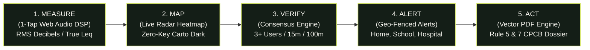

<div align="center">


<br/><br/>

### **Privacy-First Civic Acoustic Intelligence & Distributed Environmental Sensor Grid**

[](https://vitejs.dev/)
[](https://react.dev/)
[](https://www.typescriptlang.org/)
[](https://tailwindcss.com/)
[](https://leafletjs.com/)
[](https://pdf-lib.js.org/)
[](https://web.dev/progressive-web-apps/)
[](LICENSE)

<br/>

```
╔══════════════════════════════════════════════════════════════════════════════════════════╗
║  [MEASURE] ──▶ [MAP] ──▶ [VERIFY] ──▶ [ALERT] ──▶ [ACT]                                  ║
║   1-Tap Audio   Live Radar  3+ Consensus  Geo-Push   CPCB Legal Dossier (Rule 5 & 7)     ║
╚══════════════════════════════════════════════════════════════════════════════════════════╝
```

<p align="center">
  <a href="#-overview">Overview</a> •
  <a href="#-visual-identity--high-classic-design">Visual Identity</a> •
  <a href="#-interactive-acoustic-companion">Acoustic Avatar</a> •
  <a href="#-musical-ui-tap-audio-system">Tap Audio System</a> •
  <a href="#-closed-loop-civic-pipeline">Civic Pipeline</a> •
  <a href="#-statutory-cpcb-pdf-engine">CPCB PDF Engine</a> •
  <a href="#-privacy-first-engineering">Privacy Architecture</a> •
  <a href="#-technology-stack">Tech Stack</a> •
  <a href="#-getting-started">Getting Started</a>
</p>

</div>

---

## ⚡ Overview

**NoiseMap** is a privacy-first Progressive Web App (PWA) that converts everyday smartphones into an anonymous, distributed environmental acoustic sensor grid. It enables citizens to measure sound pressure levels ($L_{eq}$), detect statutory noise violations, visualize real-time urban heatmaps in ~100m privacy sectors, and generate legally defensible Central Pollution Control Board (**CPCB 2000 Rules**) grievance dossiers in $<400\,\text{ms}$.

---

## 🎨 Visual Identity & High-Classic Design

NoiseMap utilizes a deliberate, restrained, high-classic environmental palette inspired by precision field instruments and acoustic laboratories:

* **Deep Forest (`#141E17` / `#1E2F23`):** Primary structural surface and brand grounding.
* **Warm Paper (`#FAF8F2` / `#F4F1E8`):** Readable high-contrast typography and cards.
* **Signal Lime (`#D5E66B` / `#E2F075`):** Selected emphasis, live sensor telemetry, and calibrated decibel arcs.
* **Muted Olive (`#798E69`):** Secondary resonance markers and intermediate operational bands.
* **Terracotta Amber (`#C46E50` / `#F59E0B`):** Exceedance alerts and statutory violation warnings.

### Redesigned Brand Icon System
- **Vector Symbol:** Concentric acoustic resonance arcs with topographic geodetic reticles, acoustic wave crests, and a central bio-acoustic micro-transducer core.
- **PWA Icons:** Packaged with full standalone maskable support (`pwa-192x192.png`, `pwa-512x512.png`, `apple-touch-icon.png`, `radar-icon.svg`, and sharp browser `favicon.svg`).

---

## 🤖 Interactive Acoustic Companion ("The NoiseMap Guardian")

Positioned inside the circular Citizen Acoustic Sensor interface, the companion dynamically communicates sensor states:

| State | Trigger / Level | Visual Expression | Telemetry Action |
|:---|:---|:---|:---|
| **`IDLE`** | Standby / Ready | Attentive resting smile, sage green headset | Calibrated 240° arc standby; tap to measure |
| **`LISTENING`** | 10-sec Sampling active | Focused pupils, live acoustic wave mouth, pulsing ripple ring | **Live decibel HUD** continuously updates in real-time |
| **`LOW`** | Completed $< 50.0\,\text{dB}$ | Gentle smile, smiling curved eyes, Forest Green accent | Prototype demo band: compliant quiet environment |
| **`MODERATE`** | Completed $50.0\text{--}69.9\,\text{dB}$ | Observant alert eyes, Muted Olive accent | Typical urban ambient baseline |
| **`HIGH`** | Completed $\ge 70.0\,\text{dB}$ | Alert amber eyes, concerned angled brows, Terracotta warning | Exceeds daytime threshold; prompts legal escalation |
| **`ERROR`** | Mic denied or zero signal | Neutral straight mouth, warning pupil color | Hardware guidance banner displayed |
| **`SUBMITTED`** | Consensus grid confirmed | Positive nodding smile, glowing lime halo | Triggers success chime & optional voice confirmation |

---

## 🎵 Musical UI Tap Audio System

NoiseMap integrates a synthesized Web Audio micro-interaction engine delivering pleasant acoustic feedback without heavy audio files or external servers:

1. **Musical Tactile Tap:** Dual-tone acoustic marimba ping ($784\,\text{Hz}$ fundamental G5 + $1174.6\,\text{Hz}$ warm D6 harmonic) on button clicks.
2. **Selection Harmonic:** Harmonic major interval on tab and filter switches.
3. **Success Chime:** Ascending major third (C5 to E5) on sample submission.
4. **Voice Announcements:** Optional spoken confirmation via Web Speech Synthesis.
5. **Microphone Isolation Safeguard:** **All audio playback is strictly muted before microphone activation** and stays suppressed throughout the entire 10-second sampling window to prevent speaker feedback from contaminating acoustic readings.

---

## 🔁 Closed-Loop Civic Pipeline



---

## 📄 Statutory CPCB PDF Engine & Quick Export

- **Instant 1-Click Export:** The **Incidents screen** features a prominent Quick Export banner to download the most recent verified violation dossier in 1 tap.
- **Rule 5 & 7 Compliance:** Automated citation under *The Noise Pollution (Regulation and Control) Rules, 2000* under the *Environment (Protection) Act, 1986*.
- **Client-Side Generation:** Zero server roundtrip; compiles tamper-evident vector PDFs in $<400\,\text{ms}$ via `pdf-lib`.

---

## 🔒 Privacy Architecture: Math Over Trust

1. **Zero Raw Audio Retention:** Audio is processed exclusively in transient RAM. Buffers are discarded immediately after computing RMS amplitude and $L_{eq}$. No audio files are recorded or uploaded.
2. **~100m Privacy Snapping:** GPS coordinates are mathematically quantized to 3 decimal places on the device:
   $$\text{lat}_{\text{grid}} = \frac{\lfloor \text{lat} \times 1000 \rceil}{1000}, \quad \text{lng}_{\text{grid}} = \frac{\lfloor \text{lng} \times 1000 \rceil}{1000}$$
3. **Zero-KYC Ephemeral Identity:** No login screens, phone numbers, or emails. Identity is backed by rotating cryptographic UUID tokens.

---

## 🛠️ Technology Stack

* **Frontend:** React 18, TypeScript 5.7, Vite 5.4, Tailwind CSS 3.4
* **Acoustics & DSP:** Web Audio API (`AnalyserNode`, RMS calculation, $L_{eq}$ continuous energy integration)
* **Cartography:** Leaflet 1.9, React Leaflet, CARTO Dark Matter basemap (zero-key fallback)
* **Document Generation:** `pdf-lib` (pure client-side vector compilation)
* **Persistence & Sync:** Autonomous browser `localStorage` engine with optional Supabase cloud sync

---

## 🚀 Getting Started

### Prerequisites
- Node.js 18+ (tested on Node v20/v24)
- npm or yarn

### Installation
```bash
# Clone the repository
git clone https://github.com/abhisheksharma075/NoiseMap.git
cd NoiseMap

# Install dependencies
npm install

# Start development server
npm run dev
```

### Production Build & Test
```bash
# Build production bundle
npm run build

# Run automated E2E & DSP test suites
node scripts/test-runner.js
node scripts/test-audio-dsp.js
node scripts/test-data-flow.js
```

---

<div align="center">

**Built for cleaner, quieter, healthier cities.**

</div>
