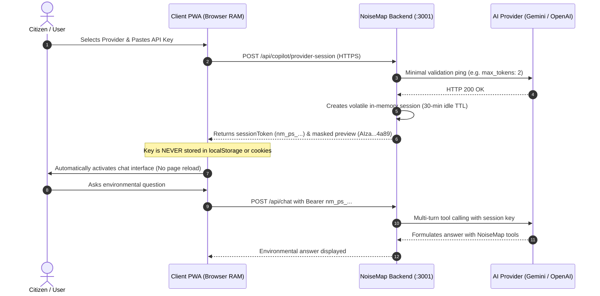

# NoiseMap AI Copilot: User API Key & Multi-Provider Guide

NoiseMap AI Copilot supports both **Google Gemini** and **OpenAI** language models with direct user API key connectivity. Users can enter their personal API credentials directly inside the progressive web application, securely validate them with the provider, and immediately converse with the environmental intelligence assistant.

---

## 1. Supported Providers & Key Acquisition

| Provider | Supported Model | Function Calling Support | Official API Key Dashboard |
| :--- | :--- | :---: | :--- |
| **Google Gemini** *(Recommended)* | `gemini-2.5-flash` | Full (All 9 NoiseMap Tools) | [https://aistudio.google.com/apikey](https://aistudio.google.com/apikey) |
| **OpenAI** | `gpt-4o-mini`, `gpt-4o` | Full (All 9 NoiseMap Tools) | [https://platform.openai.com/api-keys](https://platform.openai.com/api-keys) |

> [!NOTE]
> **OpenAI Credential Notice**: An OpenAI API key is separate from your personal ChatGPT login password. ChatGPT Plus subscription billing and OpenAI API platform credits are managed under independent billing accounts. NoiseMap will reject ChatGPT passwords and requires a standard `sk-proj-...` API key.

---

## 2. Ephemeral Session Security Architecture

NoiseMap strictly adheres to a zero-persistent-credential storage contract:

### Strict Security Guarantees:
1. **Never Stored Locally**: User API keys are **never** written to `localStorage`, `sessionStorage`, `IndexedDB`, browser cookies, or URL search parameters.
2. **Volatile Server Memory Only**: Keys are stored exclusively in the server process's in-memory session map.
3. **No Database Writes**: Provider credentials are never persisted to Postgres, Supabase, or disk logs.
4. **LRU & Idle Timeout**: Sessions automatically expire after **30 minutes of inactivity** and are purged by background garbage collection.
5. **Session Isolation**: A user's session token is bound to that client; it cannot modify global server environment variables (`process.env.GEMINI_API_KEY`) or affect other users.
6. **No Redaction Breaches**: Logs, error outputs, and telemetry responses mask all keys (`AIza...4a89` / `sk-p...3a12`).

---

## 3. Precedence & Fallback Rules

1. **User Provider Session (Highest Precedence)**: If the client provides a valid `providerSessionToken`, the backend routes requests to that user's chosen provider and key.
2. **Server Environment Default**: If no user session token is supplied, the backend falls back to server-configured keys (`process.env.GEMINI_API_KEY` or `process.env.OPENAI_API_KEY`).
3. **Unconnected State**: If neither a user session nor a server key is available, the backend responds with HTTP 401 `NO_PROVIDER_CONNECTED`, and the UI presents the **Connect Your AI Provider** screen.

---

## 4. Multi-Provider NoiseMap Tool Translation

Both Gemini and OpenAI adapters share the identical 9 read-only environmental tools defined in `server/noiseMapTools.js`:
- `get_latest_noise_readings`
- `get_noise_summary`
- `get_noise_trend`
- `get_active_incident_clusters`
- `get_incident_details`
- `get_noise_data_availability`
- `get_readings_nearby` (Haversine radius filtering)
- `suggest_map_action` (UI map navigation payloads)
- `draft_noise_complaint` (Statutory grievance drafting)

### OpenAI Tool Calling Adapter
The OpenAI adapter (`server/providers/openaiProvider.js`) dynamically maps Gemini uppercase type declarations (`STRING`, `NUMBER`, `INTEGER`, `OBJECT`, `ARRAY`) into valid lowercase JSON Schema objects required by the OpenAI Chat Completions API (`type: "function"`). It executes tool responses within an auto-iterating loop (up to 3 iterations) before returning the final text to the user.

---

## 5. Disconnection & Session Invalidation

- Clicking **`DISCONNECT`** in the header or settings modal:
  1. Issues `DELETE /api/copilot/provider-session` with the session token.
  2. Server purges the session from volatile RAM.
  3. Client wipes the token reference from application memory.
  4. Returns the user to the provider connection card without reloading the page.
- Existing crowdsourced noise readings, incident clusters, and user streaks are **never deleted** on disconnect.

---

## 6. Troubleshooting

| Error Code | Meaning | User Action |
| :--- | :--- | :--- |
| `INVALID_API_KEY` | Key rejected by provider (HTTP 400/401/403). | Ensure the key matches the selected provider. For OpenAI, ensure you pasted an API platform key (`sk-proj-...`), not your personal ChatGPT password. |
| `QUOTA_EXCEEDED` / `BILLING_RESTRICTION` | API account rate limit or credit ceiling reached (HTTP 429). | For Gemini, check quota in Google AI Studio. For OpenAI, add usage credits at `platform.openai.com/account/billing`. |
| `SESSION_EXPIRED` | 30 minutes of idle time elapsed. | Click **Settings** or reconnect your key to establish a new volatile session. |
| `NETWORK_ERROR` | Unable to contact Google or OpenAI endpoints. | Check local network connectivity, proxies, or firewall settings. |
