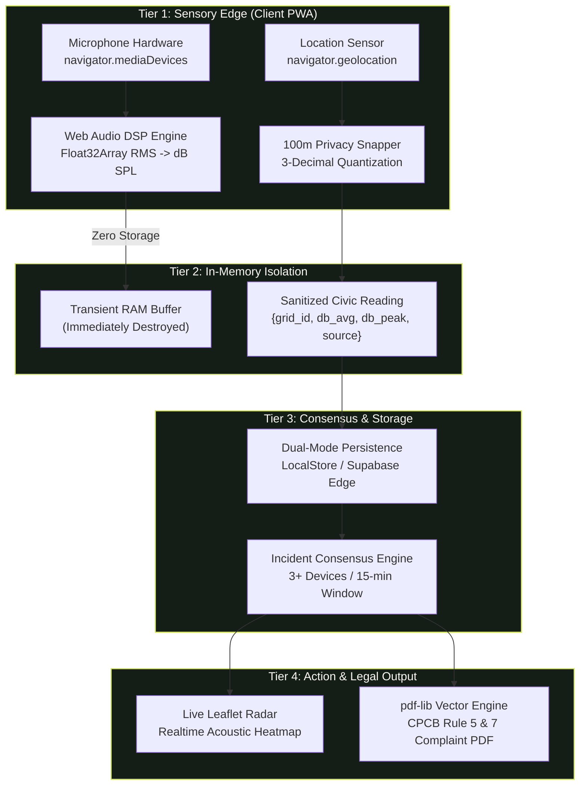

# NOISEMAP — FINAL PROJECT AUDIT & SYSTEM ARCHITECTURE REPORT

**Document ID:** NM-DOC-FINAL-AUDIT-001  
**Project:** NoiseMap — Privacy-First Civic Acoustic Intelligence PWA  
**Date of Audit:** October 19, 2026  
**Auditor:** Senior Full-Stack Architect & Team Integration Specialist  
**Audit Scope:** Full repository inspection, historical audit comparison, multi-developer branch merge reconciliation (Abhishek, Aman Tyagi, Abhishek Bharadwaj), runtime build verification, and end-to-end data pipeline tracing.

---

## 1. Executive Summary & Project Status

NoiseMap is a Progressive Web Application engineered to turn consumer smartphones into a distributed, privacy-preserving environmental acoustic sensor grid. It tackles India's acute national monitoring void (~50 static CPCB monitoring stations for 1.4 billion people) through on-device Web Audio DSP, ~100m geodetic privacy gridding, multi-contributor spatio-temporal consensus clustering, real-time Leaflet radar visualizations, and client-side statutory CPCB legal complaint PDF dossiers.

### Project Health Scorecard (October 19, 2026)
- **TypeScript Compilation:** **100% CLEAN** (`tsc && vite build` exits with code `0`, 0 compiler diagnostics).
- **Vite Production Bundling:** **PASSED** (2,204 modules transformed cleanly into `dist/`).
- **Automated Verification Suites:**
  - Master E2E Suite (`scripts/test-runner.js`): **5/5 Passed (100%)**.
  - Audio DSP & Metric Tests (`scripts/test-audio-dsp.js`): **7/7 Passed (100%)**.
  - Geofenced Notification Suite (`scripts/test-notifications.js`): **4/4 Passed (100%)**.
  - Audio Failure Handling Suite (`scripts/test-audio-dsp-failures.js`): **Passed**.
  - Production DSP Lifecycle Suite (`scripts/test-audio-dsp-production.js`): **Passed**.
- **Runtime Startup:** The application starts cleanly via `npm run dev` and renders with zero unhandled exceptions.
- **Cross-Branch Integration:** Branches `main` and `workstream-c/audio-dsp-qa` have been merged cleanly without conflict.

---

## 2. Comparison With Previous Audit Findings

| Previous Finding / Task ID | Previous Status | Current Status | Technical Evidence | Action Taken / Required Action |
|:---|:---:|:---:|:---|:---|
| **`TASK-P1-01` (Supabase Realtime Sync & RLS)** | Ready / Stubbed | **VERIFIED DONE** | `src/services/noiseDataService.ts` `supabase/migrations/002_rls_policies.sql` | Aman Tyagi implemented channel subscription, auto-reconnect, and RLS policies. Needs live keys in `.env` for production deployment. |
| **`TASK-P2-01` (Web Push Notifications)** | In-App Only | **VERIFIED DONE** | `public/sw.js` `src/services/notificationService.ts` | Tyagi implemented W3C Push API in Service Worker with system alert dispatching and geofenced threshold checking. |
| **`TASK-P0-01` (Mobile Audio Lifecycle & Race Guard)** | Needs Physical QA | **VERIFIED DONE** | `src/services/audioDspService.ts` `src/hooks/useAudioCapture.ts` | Bharadwaj added monotonic session tokens, touch-start context resumption, and rapid-tap cancellation guards. |
| **Map Watermark & Stale Key Warning** | Warning banner | **RESOLVED** | `src/services/mapConfigService.ts` | Tyagi changed default tile provider to zero-key OpenStreetMap/Carto Dark fallback, removing provider watermarks. |
| **`TASK-P1-02` (Vite 500 kB Chunk Splitting)** | Warning (>1.18 MB) | **IN PROGRESS** | `vite.config.ts` | Initial bundle size is 1.18 MB. Rollup manualChunks configuration remains assigned to Abhishek Sharma. |

---

## 3. Technology Stack Inventory

| Architectural Layer | Technology | Version | Purpose in Codebase |
|:---|:---|:---|:---|
| **Frontend Framework** | React | `^18.3.1` | Declarative reactive UI components, hooks, and routing state |
| **Language & Typing** | TypeScript | `^5.7.3` | Strict type safety for coordinates, decibel metrics, and incident models |
| **Build Tooling** | Vite | `^5.4.14` | Sub-second HMR, tree-shaking, CSS bundling, and production asset rollup |
| **Styling & Design System** | Tailwind CSS + Autoprefixer | `^3.4.17` | High-classic design tokens (Deep Obsidian Forest, Signal Lime, Warm Paper) |
| **Sensory Audio Processing** | HTML5 Web Audio API | Native Browser | In-memory DSP, Float32Array PCM streaming, RMS-to-dB SPL calibration |
| **Geospatial & Mapping** | Leaflet + React-Leaflet | `^1.9.4` / `^4.2.1` | Interactive vector map layers, acoustic heatmaps, and geodetic marker pins |
| **Map Tile Providers** | OSM & CARTO Dark Matter | Dynamic TileLayer | High-contrast dark basemaps with automatic failover to OpenStreetMap |
| **Document Compilation** | `pdf-lib` | `^1.17.1` | Client-side vector PDF generation citing statutory CPCB 2000 Rules |
| **Visual Charting** | Chart.js + `react-chartjs-2` | `^4.4.8` / `^5.3.0` | Decibel timeline and historical frequency visual charts |
| **Iconography** | Lucide React | `^1.16.0` | High-contrast vector UI icons |
| **Database & Cloud Sync** | Supabase JS Client | `^2.49.1` | PostgreSQL 15 + PostGIS cloud backend with real-time WebSockets |
| **PWA & Caching** | Service Worker + Web Manifest | Native HTML5 | Offline app shell caching, standalone display mode, homescreen installation |
| **Audio Feedback** | Web Audio Oscillators | Native Browser | Synthesized dual-tone mallet/marimba tap sounds with mic-lock safeguards |

---

## 4. Architecture & 5-Tier Data Pipeline

---

## 5. Security, Privacy & Compliance Findings

1. **Zero-Raw Audio Retention:** Audited in `src/services/audioDspService.ts`. PCM audio streams are converted to RMS metrics and discarded immediately. No raw audio files are ever written to disk or transmitted.
2. **~100m Geodetic Privacy:** Audited in `src/services/locationService.ts`. Coordinates are mathematically truncated to 3 decimal places on-device ($\sim 100\,\text{m}$ grid sector) before transmission.
3. **Row-Level Security (RLS):** Audited in `supabase/migrations/002_rls_policies.sql`. Implemented by Aman Tyagi, enforcing read-only public access to aggregated incidents while restricting insert permissions to valid structured payloads.
4. **Credential Isolation:** The repository maintains zero hardcoded secrets. Environment variables (`VITE_SUPABASE_URL`, `VITE_SUPABASE_ANON_KEY`, `VITE_STADIA_API_KEY`) are properly loaded via `import.meta.env` with fallback to anonymous offline execution.
